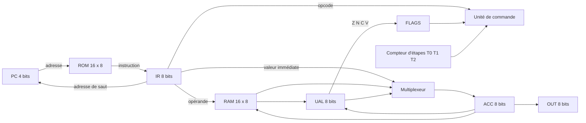

# RG-8 : un processeur 8 bits construit porte par porte

[](https://github.com/RIZIWYX/Mini-CPU/actions)


[](LICENSE)

RG-8 est un processeur 8 bits conçu dans [Logisim-evolution](https://github.com/logisim-evolution/logisim-evolution), construit **uniquement à partir de portes logiques** : aucun additionneur, registre, compteur ni mémoire de la bibliothèque Logisim. Les bascules elles-mêmes sont faites en portes NAND.

Il est programmable avec un **assembleur Python** qui écrit le programme directement dans la mémoire du circuit.

<!-- Démo : remplacer par le GIF de la multiplication -->
<!--  -->

## Ce qu'il sait faire

```asm
; Multiplication 6 x 7 par additions successives
boucle: LDI 6
        ADD 13          ; résultat = résultat + 6
        STA 13
        LDA 14
        SUB 15          ; compteur = compteur - 1
        STA 14
        JZ fin
        JMP boucle
fin:    LDA 13
        OUT             ; affiche 42
```

## Caractéristiques

- Données sur **8 bits**, adresses sur **4 bits**
- Mémoire programme de 16 instructions, mémoire de données de 16 octets
- UAL 8 bits : ADD, SUB, AND, OR, NOT, avec les drapeaux Z, N, C et V
- **15 instructions**, dont des sauts conditionnels JZ, JC et JN (voir [le jeu d'instructions](docs/isa.md))
- Unité de commande en **logique câblée**, cycle en 3 étapes (voir [l'unité de commande](docs/controle.md))
- Arrêt du processeur par l'instruction HLT
- **Assembleur Python** : étiquettes, commentaires, messages d'erreur avec numéro de ligne, écriture dans la ROM, 23 tests `pytest`

## Architecture



Tous les circuits sont construits à partir de circuits plus simples, jusqu'aux portes logiques. Le détail est dans [docs/architecture.md](docs/architecture.md).

## Lancer un programme

1. Installer [Logisim-evolution](https://github.com/logisim-evolution/logisim-evolution) (version 3.8 ou supérieure) et Python 3.
2. **Fermer Logisim**, puis assembler un programme et l'écrire dans la ROM :
   ```
   python3 assembleur/assembleur.py programmes/mult.asm --rom circuits/rg8.circ
   ```
3. Ouvrir `circuits/rg8.circ`, mettre `raz` à 1 puis à 0.
4. Lancer l'horloge avec `Simulation > Horloge activée` (Ctrl+K). La sortie `s_out` affiche le résultat.

Sans l'option `--rom`, l'assembleur affiche seulement les 16 octets du programme.

## Programmes d'exemple

| Fichier | Résultat |
|---|---|
| `programmes/addition.asm` | 5 + 3 : affiche 8 puis s'arrête |
| `programmes/rebours.asm` | affiche 3, 2, 1, 0 puis s'arrête |
| `programmes/mult.asm` | 6 × 7 : affiche 42 |

## Tests

```
python3 -m pytest -q assembleur/tests
```

## Organisation du dépôt

| Dossier | Contenu |
|---|---|
| `circuits/` | Le processeur et tous ses sous-circuits (`rg8.circ`) |
| `assembleur/` | Assembleur Python et ses tests |
| `programmes/` | Programmes d'exemple en assembleur |
| `docs/` | Jeu d'instructions, architecture, unité de commande |

## Auteur

Rayane Graïne - [GitHub](https://github.com/RIZIWYX) - [LinkedIn](https://linkedin.com/in/rayane-graine)
