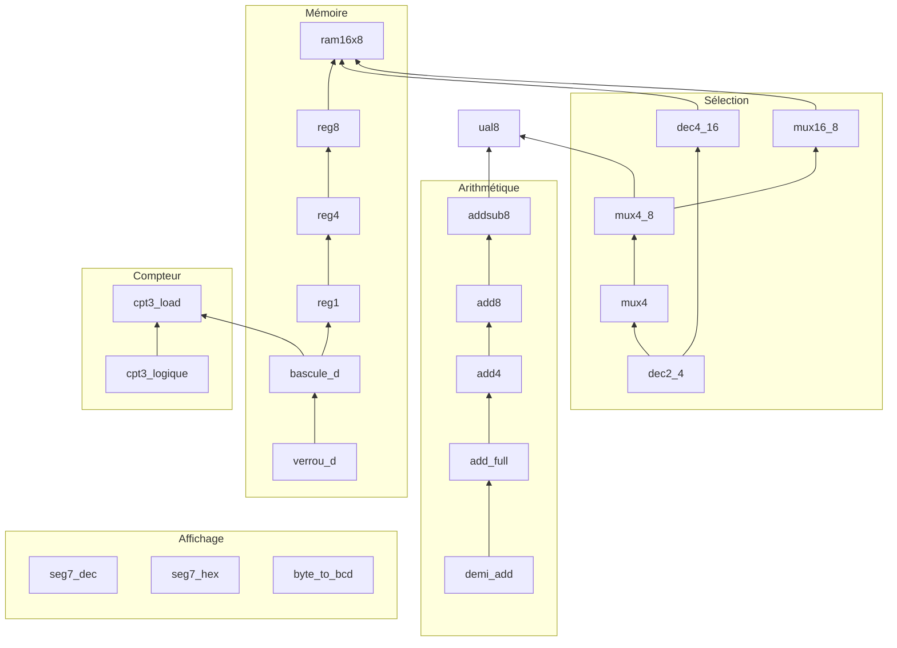

# Architecture des circuits

Tous les circuits sont dans `circuits/rg8.circ`. Ils sont rangés **du plus simple au plus complexe**, par famille. Chaque circuit n'utilise que des portes logiques et des circuits placés au-dessus de lui dans la liste.

## Qui utilise qui

Une flèche `A --> B` signifie : **B est construit avec A**.

## Détail par famille

### Arithmétique

| Circuit | Construit avec | Rôle |
|---|---|---|
| `demi_add` | XOR, AND | Addition de 2 bits |
| `add_full` | 2 × `demi_add`, XOR | Addition de 2 bits + retenue |
| `add4` | 4 × `add_full` | Addition sur 4 bits |
| `add8` | 2 × `add4` | Addition sur 8 bits |
| `addsub8` | `add8`, 8 × XOR | Addition ou soustraction sur 8 bits |

### Sélection

| Circuit | Construit avec | Rôle |
|---|---|---|
| `dec2_4` | NOT, AND | Adresse 2 bits → 1 sortie active parmi 4 |
| `dec4_16` | 2 × `dec2_4`, 16 × AND | Adresse 4 bits → 1 sortie active parmi 16 |
| `mux4` | `dec2_4`, AND, OR | Choisit 1 bit parmi 4 |
| `mux4_8` | 8 × `mux4` | Choisit 1 valeur de 8 bits parmi 4 |
| `mux16_8` | 5 × `mux4_8` | Choisit 1 valeur de 8 bits parmi 16 |

### Calcul

| Circuit | Construit avec | Rôle |
|---|---|---|
| `ual8` | `addsub8`, `mux4_8`, AND, OR, NOT, NOR, XOR | UAL 8 bits : ADD, SUB, AND, OR, NOT, drapeaux Z, N, C, V |

### Mémoire

| Circuit | Construit avec | Rôle |
|---|---|---|
| `verrou_d` | NAND, NOT | Mémorise 1 bit tant que `en` = 1 |
| `bascule_d` | 2 × `verrou_d`, NOT | Mémorise 1 bit au front montant de `clk` |
| `reg1` | `bascule_d`, AND | Registre 1 bit avec écriture, lecture, activation |
| `reg4` | 4 × `reg1` | Registre 4 bits |
| `reg8` | 2 × `reg4` | Registre 8 bits |
| `ram16x8` | 16 × `reg8`, `dec4_16`, `mux16_8` | Mémoire de 16 cases de 8 bits |

### Compteur

| Circuit | Construit avec | Rôle |
|---|---|---|
| `cpt3_logique` | NOT, AND, OR | Calcule la valeur suivante du compteur |
| `cpt3_load` | 3 × `bascule_d`, `cpt3_logique` | Compteur 0 → 5 avec chargement |

### Affichage

| Circuit | Construit avec | Rôle |
|---|---|---|
| `seg7_dec` | NOT, AND, OR | Chiffre décimal → afficheur 7 segments |
| `seg7_hex` | NOT, AND, OR | Chiffre hexadécimal → afficheur 7 segments |
| `byte_to_bcd` | ⚠️ diviseur Logisim | Octet → centaines, dizaines, unités (à refaire en portes) |

## Circuits à revoir

| Circuit | Statut |
|---|---|
| `byte_to_bcd` | Utilise encore un composant Logisim, à refaire en portes |
| `ual1` | N'est plus utilisé, remplacé par `ual8` |
