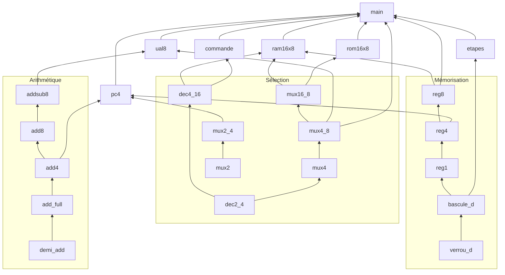

# Architecture des circuits

Tous les circuits sont dans `circuits/rg8.circ`. Chaque circuit n'utilise que des portes logiques et des circuits plus simples, testés avant d'être réutilisés.

## Qui utilise qui

Une flèche `A --> B` signifie : **B est construit avec A**.

## Détail par famille

### Arithmétique

| Circuit | Construit avec | Rôle |
|---|---|---|
| `demi_add` | XOR, AND | Addition de 2 bits |
| `add_full` | 2 × `demi_add`, XOR | Addition de 2 bits + retenue |
| `add4` | 4 × `add_full` | Addition sur 4 bits |
| `add8` | 2 × `add4` | Addition sur 8 bits |
| `addsub8` | `add8`, 8 × XOR | Addition ou soustraction sur 8 bits |

### Sélection

| Circuit | Construit avec | Rôle |
|---|---|---|
| `dec2_4` | NOT, AND | Adresse 2 bits → 1 sortie active parmi 4 |
| `dec4_16` | 2 × `dec2_4`, 16 × AND | Adresse 4 bits → 1 sortie active parmi 16 |
| `mux2` | NOT, AND, OR | Choisit 1 bit parmi 2 |
| `mux2_4` | 4 × `mux2` | Choisit 1 valeur de 4 bits parmi 2 |
| `mux4` | `dec2_4`, AND, OR | Choisit 1 bit parmi 4 |
| `mux4_8` | 8 × `mux4` | Choisit 1 valeur de 8 bits parmi 4 |
| `mux16_8` | 5 × `mux4_8` | Choisit 1 valeur de 8 bits parmi 16 |

### Calcul

| Circuit | Construit avec | Rôle |
|---|---|---|
| `ual8` | `addsub8`, `mux4_8`, AND, OR, NOT, NOR, XOR | UAL 8 bits : ADD, SUB, AND, OR, NOT, drapeaux Z, N, C, V |

### Mémorisation

| Circuit | Construit avec | Rôle |
|---|---|---|
| `verrou_d` | 4 × NAND, NOT | Mémorise 1 bit tant que `en` = 1, avec mise à 1 et remise à zéro |
| `bascule_d` | 2 × `verrou_d`, NOT | Mémorise 1 bit au front montant de `clk` (maître-esclave) |
| `reg1` | `bascule_d`, AND | Registre 1 bit avec écriture et activation |
| `reg4` | 4 × `reg1` | Registre 4 bits |
| `reg8` | 2 × `reg4` | Registre 8 bits |
| `ram16x8` | 16 × `reg8`, `dec4_16`, `mux16_8` | Mémoire de données, 16 cases de 8 bits |
| `rom16x8` | 16 constantes, `mux16_8` | Mémoire programme, 16 instructions |

### Processeur

| Circuit | Construit avec | Rôle |
|---|---|---|
| `pc4` | `reg4`, `add4`, `mux2_4` | Compteur ordinal : PC + 1, ou adresse de saut |
| `etapes` | 2 × `bascule_d`, NOR | Compteur d'étapes T0 → T1 → T2 → T0 |
| `commande` | `dec4_16`, AND, OR | Unité de commande en logique câblée (voir [controle.md](controle.md)) |
| `main` | tous les circuits ci-dessus | Le processeur RG-8 complet |

### Affichage (non utilisés dans le processeur)

| Circuit | Construit avec | Rôle |
|---|---|---|
| `seg7_dec` | NOT, AND, OR | Chiffre décimal → afficheur 7 segments |
| `seg7_hex` | NOT, AND, OR | Chiffre hexadécimal → afficheur 7 segments |
| `byte_to_bcd` | diviseur Logisim | Octet → centaines, dizaines, unités (à refaire en portes) |

### Anciens circuits

| Circuit | Statut |
|---|---|
| `cpt3_logique`, `cpt3_load` | Premier compteur 3 bits, remplacé par `pc4` et `etapes` |

## Une règle à respecter dans Logisim

Dans un bloc dessiné automatiquement par Logisim, l'ordre des entrées de haut en bas suit l'ordre des pins à l'intérieur du sous-circuit. Déplacer une pin au-dessus d'une autre décâble donc tous les circuits qui utilisent ce bloc.

Les blocs `mux4`, `verrou_d`, `reg1`, `ual8`, `ram16x8` et `pc4` ont un dessin fixe (apparence personnalisée) : leurs pins peuvent être déplacées sans rien casser. Si on ajoute ou retire une pin dans l'un d'eux, il faut mettre à jour son dessin.
